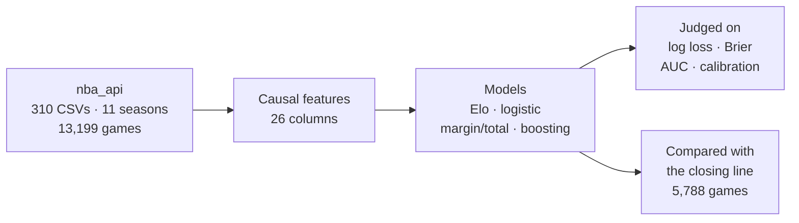

<div align="center">

# Legit NBA Predictions

**An audit of a popular NBA betting model, and an honest measurement of how much of the game is actually predictable.**

[](https://github.com/wippa-studios/Legit-NBA-Predictions/actions/workflows/ci.yml?query=branch%3Aimprove-model-v2)
[](https://github.com/wippa-studios/Legit-NBA-Predictions/actions/workflows/ci.yml)
[](https://github.com/swar/nba_api)
[](https://github.com/kyleskom/NBA-Machine-Learning-Sports-Betting)
[](results_pipeline_b.md#pipeline-b-the-model-against-the-market)

[Key findings](#key-findings) ·
[Quick start](#quick-start) ·
[Results](#results-at-a-glance) ·
[The audit](#the-audit) ·
[Repo layout](#repository-layout) ·
[Limitations](#limitations) ·
[Docs](#documentation)

</div>

---

A fork of [kyleskom/NBA-Machine-Learning-Sports-Betting](https://github.com/kyleskom/NBA-Machine-Learning-Sports-Betting) (1,744 stars, 569 forks, maintained since 2019). It does two things:

1. **Fixes the defects it found in the original**, starting with a headline accuracy that turned out to be target leakage.
2. **Rebuilds the modelling layer from NBA's own data**, so every result can be read against every other, and against the closing betting line.

> **There is no demonstrated betting edge here, and we do not claim one.** This repository is an audit and a set of prediction models, judged on how well they predict, not on whether they make money.

> **Credit.** All original code, pipelines and model scripts are the work of **Kyle Skompinski and contributors** ([github.com/kyleskom](https://github.com/kyleskom)). Kyle built a substantial, well-maintained project in good faith. The defects documented here are the ordinary accumulation of years of iteration by one maintainer, and most are invisible without measuring rather than reading. This fork corrects; it does not replace. The audit, corrections and documentation in this fork are ours.

---

## Key findings

| | |
|---|---|
| **The 68.9% headline was target leakage** | Season-to-date stats were scraped with the game's own result already included. Rebuilt without the leak, accuracy is ~48% on the affected rows. |
| **The market beats the model decisively** | On 5,788 games with both a prediction and a closing line: market log loss **0.59766** vs model + availability **0.62034**. A gap of 0.02268 nats, interval entirely on the market's side (\|z\| = 7.28). That is a loss, not a tie. |
| **Selective betting does not rescue it** | The parameter-free rule (bet wherever the model beats the posted price, both sides considered) places 4,828 bets and returns **−8.23%**. No margin or threshold cell reaches \|z\| = 3. The sweep's one positive cell, +3.99%, is \|z\| = 0.46 noise. |
| **One mechanism genuinely works** | Player-level *expected minutes* (availability) improves log loss by **+0.00390** nats at **\|z\| = 4.78**, the only effect here that clears the project's \|z\| > 3 bar honestly. The closing line already prices it in. |
| **The biggest-looking win was a leak** | A per-player Elo block measured \|z\| = 5.18 and was leaking the real lineup. On a pre-game roster it is +0.00065 and does not earn its place. |
| **The simplest sensible model wins** | Logistic regression (log loss **0.6157**) beats XGBoost, HistGradientBoosting, random forest, Gaussian NB and margin/total models. Every run is logged in `results/experiments.jsonl`. |
| **The close absorbs everything our model knows** | Price + model loses to price alone by 0.00177 nats (\|z\| 3.15). Availability beyond price + model is a tight null. |
| **The null is the field's finding too** | Of ~45 public NBA repos surveyed, accuracy tops out at 65–69%, and only two say plainly that they lose to the market. |
| **Do not use the committed model files** | They were trained on the leaked dataset and must be retrained. |

---

## Quick start

Python **3.10 or 3.11** (the ceiling is deliberate: `tensorflow==2.14.0` has no wheels for 3.12+).

```bash
pip install -r requirements.txt

# Reproduce every number in this README (opens with a leakage gate)
python scripts/evaluate.py

# Pipeline A: NBA-data models
python scripts/download_nba_data.py          # resumable; core = 11 seasons
python -m src.Models.logreg_rolling          # the canonical model
python scripts/closing_line.py               # does it beat the closing line?
```

> ⚠️ The model files committed in `Models/` predate every fix in this fork. **Retrain before using anything**, see [Models, features and retraining](models_and_training.md).

---

## Two pipelines

Knowing which one you are using is the most useful thing to settle first.

| | **A. NBA-data models** (new) | **B. Original betting pipeline** (fixed) |
|---|---|---|
| **Purpose** | Predict game outcomes and measure how good the predictions are | Predict games against sportsbook odds, with Kelly sizing |
| **Data** | NBA's own data via `nba_api` (310 CSVs, 11 seasons, 13,199 games) | Scraped team stats and sportsbook odds |
| **Models** | Elo, logistic regression, margin/total, gradient boosting | XGBoost and neural networks |
| **Judged on** | Log loss, Brier, AUC, calibration | Accuracy, log loss, market baseline, ROI |
| **Entry points** | `scripts/download_nba_data.py`, `python -m src.Models.*` | `main.py`, `src/Process-Data/`, `src/Train-Models/` |

How pipeline A flows:



Every feature for a game is computed **only from games that already happened**. That is tested rather than asserted: deleting 5,199 future games changes no historical feature by more than `0.000e+00`.

---

## Results at a glance

Two rules apply to everything below. **Log loss leads; accuracy is reported but never ranked**, because always predicting "home" scores 55%. And the project's bar for calling something real is **\|z\| > 3**, following Vandenbruaene et al. 2022 (*J Sports Econ* 23(7)).

### Prediction quality (Pipeline A)

All models scored on the same 6,600 walk-forward test rows across five splits. Lower log loss and Brier are better; higher AUC is better.

| model | log loss ↓ | Brier ↓ | AUC ↑ | accuracy |
|---|---|---|---|---|
| always predict home | 0.6883 | 0.2476 | 0.5010 | 0.5527 |
| SRS + intercept (walk-forward) | 0.6890 | 0.2479 | 0.5020 | 0.5500 |
| Bradley-Terry (walk-forward) | 0.6929 | 0.2494 | 0.5514 | 0.5568 |
| Elo (K=20, FiveThirtyEight default) | 0.6300 | 0.2187 | 0.7055 | 0.6594 |
| Elo (K=10, tuned on validation) | 0.6260 | 0.2180 | 0.7020 | 0.6512 |
| log-linear on Elo | 0.6234 | 0.2169 | 0.7026 | 0.6542 |
| XGBoost | 0.6233 | 0.2167 | 0.7030 | 0.6562 |
| HistGradientBoosting | 0.6236 | 0.2169 | 0.7026 | 0.6526 |
| margin + total → Φ(m̂/σ) | 0.6204 | 0.2156 | 0.7074 | 0.6562 |
| logistic regression, availability off (pre-#36) | 0.6196 | 0.2151 | 0.7085 | 0.6564 |
| **logistic regression (canonical, 26 features)** | **0.6157** | **0.2133** | **0.7141** | **0.6573** |

Boosting loses significantly to the canonical model (XGBoost Δ −0.00785, CI [−0.01038, −0.00533]). Player ratings, rank columns, recency weighting and the rebound block are all nulls. [Full comparison and experiment log →](results_pipeline_a.md)

### Model against the market (Pipeline B)

| scorer | log loss ↓ | Brier ↓ | AUC ↑ | accuracy |
|---|---|---|---|---|
| always bet home | 0.68791 | 0.24738 | 0.5000 | 0.5511 |
| **market (closing ML, de-vigged)** | **0.59766** | **0.20573** | **0.7363** | **0.6818** |
| model | 0.62340 | 0.21685 | 0.7034 | 0.6513 |
| model + availability | 0.62034 | 0.21540 | 0.7082 | 0.6543 |

Model + availability trails the market by **0.02268** nats, CI [0.01638, 0.02859]. That gap is roughly 6× the best prediction improvement found here. Betting wherever the model beats the posted price returns **−8.23%** over 4,828 bets, and a threshold chosen on ten seasons and scored on the eleventh pools to **−2.53%**. [Market analysis, betting rules and a measurement-bug post-mortem →](results_pipeline_b.md)

### What survived measurement, and what did not

| candidate | Δ log loss | \|z\| | verdict |
|---|---|---|
| **player-level expected minutes (availability)** | +0.00390 | 4.78 | **real**, and fully priced at the close |
| per-team home/away split | −0.00089 | 2.29 | replicated, below the bar |
| schedule block (rest, back-to-back, travel) | −0.00204 | 2.55–2.76 | stable lead, below the bar |
| strength of schedule | −0.00008 | 2.01 | died in replication at 8 folds |
| player Elo, pre-game roster | +0.00065 | 2.14 | does not earn its place |
| *player Elo, real lineup* | *−0.00645* | *5.18* | ***a leak**, the biggest fake win here* |
| nine further candidate blocks (travel, volatility, momentum, shot mix, era, …) | best +0.00026 | 1.19 | all null |
| isotonic / Platt recalibration | −0.0129 | 4.56 | significantly *harmful* |

Sign convention differs by row; the full tables, intervals and the reasoning behind each are in [the one thing that is not a null](results_pipeline_a.md#the-one-thing-that-is-not-a-null), [the feature search](results_pipeline_a.md#the-feature-search-four-candidates-pre-registered) and [the player-Elo leak](player_elo_leak.md).

---

## The audit

Six defects in the original, all measured on the committed data. Reproduce with `python scripts/evaluate.py`.

| # | Defect | Impact |
|---|---|---|
| 1 | **Target leakage.** `DateTo` was inclusive, so each snapshot contained the game's own result | Headline accuracy and ROI inflated |
| 2 | **No market baseline** | Model never compared against the closing line |
| 3 | **Totals model has no signal** | 0.497 vs 0.504 for always predicting "over" |
| 4 | **Harmful calibration** | Class weighting skewed probabilities ~6 points; calibrator fit on unweighted labels |
| 5 | **Leaked API key** | Live RapidAPI credential committed since 2023, plus a debug server that exposed source |
| 6 | **Engineering gaps** | No CI, untested code, 255 games silently dropped, postponed games labelled as losses |

The leak was not uniform. Older seasons were scraped before tip-off and are genuinely pre-game; recent seasons were backfilled afterwards. So the chronological split put mostly-clean data in training and **94.3% poisoned data in the test set**:

| year | as shipped | rebuilt |
|---|---|---|
| 2024 | 68.0% | 48.1% |
| 2025 | 96.1% | 45.6% |
| 2026 | **100.0%** | 38.5% |

Leakage was worth roughly **+2.8 points of accuracy and +6 points of phantom ROI**. [All six defects, with evidence →](audit_and_fixes.md#what-the-audit-found)

### What this fork changes

- **Correctness.** Games join to the most recent stats snapshot *strictly before* the game date. Postponed and phantom-tie games are excluded. One shared days-rest implementation replaces three divergent ones. Both runners assert the inference frame matches the training column order.
- **Evaluation.** Class weighting off by default; four disjoint chronological segments; fixed seeds; imputation fitted inside each fold; log loss, the closing-line baseline and realised ROI reported, not accuracy alone.
- **Security.** API key read from `RAPIDAPI_KEY` and endpoints fail closed; debug mode removed; every network call has a timeout.
- **Engineering.** CI on Python 3.10–3.11, `pyproject.toml`, declared dependencies, six near-identical trainers collapsed into shared modules (2,255 → 1,551 lines, byte-identical output).
- **Reference tooling.** One importable leakage gate (`src/Utils/leakage_gate.py`) that separates a **confirmed future-dated leak** from a **same-date dependency to investigate**, tested against the three known-fatal patterns and their clean counterparts.

[Full list, plus the evaluation tooling added →](audit_and_fixes.md#what-this-fork-changes)

### The reusable leakage gate

The audit's most instructive result was a leak that truncation could not see: the
player-Elo block scored \|z\| = 5.18 by summing over the players who *actually
played*. The weights were causal; the **membership** was not.

`src/Utils/leakage_gate.py` turns that lesson into a tool. It is one importable
function, `audit_future_dependence(build_features, frame, date_col, row_key)`,
with no dependency on this repository's data layout — copy it into another
project and pass that project's feature builder.

| probe | question it asks | how to read a change |
|---|---|---|
| `as_of` | does the feature read a **later-dated** record? | **a real leak.** Trust it. |
| `blind` | does it read **other records sharing its date**? | a membership dependency. Investigate; do not conclude. |
| `self` (optional) | does it read **its own row**? | expected for causal self-reference; diagnostic only. |

The split is the point. An earlier single-probe design deleted the probe event's
own row, so every trailing average was flagged by construction — the gate cried
wolf on exactly the features that were clean. Keeping the event's own row makes
`blind` fair to self-reference while still catching the membership shape. The
report keeps the answers in separate collections (`leaks`,
`membership_dependencies`, `self_dependencies`), and its summary never calls a
blind finding a leak.

The gate is tested against the three known-fatal patterns — **the 68.9%
headline, player-Elo over the actual squad, availability over the actual squad**
— and against their clean counterparts, including a strictly causal trailing
mean that must pass. [The API, the fixtures and what the gate cannot see →](docs/leakage_gate.md)

---

## Repository layout

```text
.
├── main.py                    # original betting pipeline entry point (Pipeline B)
├── config.toml                # seasons and scrape configuration
├── scripts/                   # evaluate, run_experiments, closing_line, edge_betting,
│                              #   feature_block_ablation, download_nba_data, ...
├── src/
│   ├── DataProviders/         # nba_data.py: the single shared feature layer
│   ├── Models/                # baselines, ratings, margin_total, logreg_rolling,
│   │                          #   gbm, player_ratings            (Pipeline A)
│   ├── Process-Data/          # scrapers and dataset builders    (Pipeline B)
│   ├── Train-Models/          # XGBoost / logistic / NN trainers (Pipeline B)
│   └── Utils/                 # features, metrics, validation, Kelly, nba_client
├── Flask/                     # web app for browsing the daily slate
├── Models/                    # committed artifacts: STALE, retrain before use
├── data/nba/                  # downloaded NBA data (not committed)
├── Data/injury.sqlite         # append-only injury-report snapshots
├── results/                   # experiments.jsonl and per-experiment artifacts
├── Tests/                     # 40 test files
├── *.md                       # deep-dive docs, see Documentation below
└── ROADMAP.md
```

**Contributing?** Start with [Models, features and retraining](models_and_training.md). It covers the six model modules (12 approaches, 18 configurations), the one shared `load_design` feature builder, and the feature-order contract between trainers and runners.

---

## Usage

**Pipeline A**

```bash
python scripts/download_nba_data.py                       # core, 11 seasons
python scripts/download_nba_data.py --stages core,extras  # + tracking, synergy, shot charts

python -m src.Models.baselines         # the bar everything else must beat
python -m src.Models.logreg_rolling    # the canonical model
python -m src.Models.margin_total
python -m src.Models.gbm

python scripts/closing_line.py             # does any of this beat the closing line?
python scripts/availability.py             # is the availability effect attainable honestly?
python scripts/feature_block_ablation.py   # does each feature block earn its place?
python scripts/edge_betting.py             # bet only where the model beats the price
```

**Pipeline B** (retrain first)

```bash
python -m src.Process-Data.Get_Data
python -m src.Process-Data.Get_Odds_Data
python -m src.Process-Data.Create_Games
python -m src.Train-Models.XGBoost_Model_ML --dataset dataset_2012-26 --trials 15 --splits 5

python3 main.py -xgb -odds=fanduel
```

| flag | effect |
|---|---|
| `-xgb` / `-nn` / `-A` | run the XGBoost models / the neural-network models / all models |
| `-kc` | add Kelly Criterion bankroll fractions |
| `-odds=<book>` | fetch odds (`fanduel`, `draftkings`, `betmgm`, `pointsbet`, `caesars`, `wynn`, `bet_rivers_ny`) |

`--trials` defaults to **15**, not 100: at 100 trials the expected winner's curse is 2.50 standard errors, so a bigger search ranks noise.

**Flask app**

```bash
export RAPIDAPI_KEY="<your rapidapi key>"   # optional; team/player endpoints 503 without it
cd Flask && flask run
```

Never run `flask --debug run` on a reachable host: debug mode serves application source, including credentials.

[Full usage, including the `/games` route and directory-name caveats →](usage.md)

---

## Verifying and testing

```bash
python scripts/evaluate.py     # reproduces every number; refuses to report accuracy on a contaminated dataset
pytest Tests/                  # or: python -m unittest discover -s Tests -t .
```

**1,287 passing + 104 subtests, 0 failing** across 40 files. Most tests need no network, TensorFlow or XGBoost; model suites **skip** rather than fail when `data/nba` is absent, so a fresh clone still gets a meaningful signal. CI runs on Python 3.10 and 3.11, plus a matrix job covering both sides of the scikit-learn 1.7 `multi_class` removal. Every guard was added because something was measured to be wrong. [Details →](reproducing.md)

---

## Limitations

**Read this before using any number from this repository.**

### About the results

1. **No demonstrated betting edge.** This is now a *measured loss* rather than an
   absence of a result, and the distinction matters. Betting wherever the model beats
   the posted price — a rule with no free parameter, considering both sides — returns
   **−8.23%** over 4,828 bets (−10.21% over 4,855 without the availability block), and
   no margin or threshold cell reaches |z| = 3 (strongest |z|: 1.91 margin sweep, 0.62 threshold sweep). Reproduce with
   `python scripts/edge_betting.py`; the market comparison is
   `python scripts/closing_line.py`.
2. **The model is worse than the market it is trying to beat**, and the gap is now
   measured rather than inferred from accuracy. On 5,788 games with both a prediction
   and a closing line: market log loss **0.59766** against model + availability's
   **0.62034**, a gap of 0.02268 with CI [0.01638, 0.02859] — the interval excludes
   zero on the market's side, |z| = 7.28.
3. **Accuracy is not profitability, and log loss is closer to profitability than
   accuracy is.** The market has both the best accuracy (0.6818) *and* the best log
   loss (0.59766); a model could beat it on one and still lose money on the other.
   This project's accuracy (0.6573) sits mid-pack among published NBA models
   (~0.615–0.69, `repo_survey.md`), so being ordinary at 0.657 is the field's
   normal — and **no** published figure in that survey accounts for the vig, which
   this one measures directly at +4.13% (`python scripts/edge_betting.py`). Those
   accuracy numbers cannot be read as returns.
4. **The `68.9%` figure is retired.** It is reproduced here only to explain the leak.
   It is not a forecasting result.
5. **Effect sizes here are small, and the honest bar is high.** Everything measured
   is of order 0.001–0.03 nats. This project holds itself to |z| > 3, from
   Vandenbruaene et al. 2022 (*J Sports Econ* 23(7)), where the null of
   unprofitability was never rejected across 628 implementations after
   multiple-testing correction. A single 95% interval is not enough; **ten blocks
   are** now scored against one full frame, and the largest of them reaches |z| = 2.59,
   still short of the bar. The one effect that clears it is the availability block now
   in the canonical model (Δ +0.00390, |z| = 4.78 —
   [the one thing that is not a null](results_pipeline_a.md#the-one-thing-that-is-not-a-null)); everything
   else measured here is short of the bar or a leak.

### About the code and models

6. **The committed model artifacts predate every fix in this fork and must be
   retrained before use.** They were fitted on the leaked dataset above, and
   `Models/NN_Models/Trained-Model-OU-49.2.keras` additionally carries the old
   totals column order — it has 107 inputs either way, so nothing will raise, it will
   simply be wrong. Treat everything in `Models/` as untrusted until retrained.
7. **The totals model should not be used.** It does not beat a coin flip or a constant
   prior.
8. **Kelly sizing is full Kelly** with no fractional scaling, bankroll cap,
   simultaneous-exposure limit, or discount for model uncertainty. Full Kelly on a
   marginally-uncertain edge has a high probability of severe drawdown.

### Legal and usage

9. **Not financial advice.** Nothing here is a recommendation to wager. Sports betting
   carries real financial risk; this is an educational data-science project.
10. **Data provenance.** Team stats come from `stats.nba.com` (whose Terms of Use
     restrict redistribution) and odds from a scraped source. Neither is licensed for
     redistribution by this project.
11. **No license.** Neither this fork nor its upstream grants reuse rights.

---

## Documentation

**Deep dives** (the long-form content that used to live in this README)

| doc | what it covers |
|---|---|
| [The audit and the fixes](audit_and_fixes.md) | The original project, the six defects, everything this fork changed, and the tooling added |
| [Models, features and retraining](models_and_training.md) | Model modules, `load_design`, retraining commands, the feature-order contract |
| [Results: Pipeline A](results_pipeline_a.md) | Model comparison, the 17-run experiment log, the experiment ledger, feature blocks |
| [Results: Pipeline B](results_pipeline_b.md) | Closing-line comparison, betting rules, rotations data, survey of other repos |
| [Usage](usage.md) | Full commands for both pipelines and the Flask `/games` route |
| [Verifying and testing](reproducing.md) | Reproducing every number, the experiment-log CLI, the test suite |
| [The agent swarm](agent_swarm.md) | How the measurement work was done, and what it got wrong |

**Research notes**

| doc | what it covers |
|---|---|
| [The market anchor](market_anchor.md) | Why odds are legitimate as an input only here; the close absorbs everything the model knows |
| [The totals target](docs/totals_target.md) | Why `OU-Cover` keeps its push class, what a void bet means, and the closing price that would justify folding it |
| [The availability block](availability_block.md) | The one mechanism that survived: expected minutes over the prior game's squad |
| [The injury-report pipeline](injury_pipeline.md) | Point-in-time availability as append-only evidence |
| [The October 2026 experiment campaign](experiment_log_2026-10.md) | Every experiment from declared rationale to verdict, plus errata |
| [The player-Elo leak](player_elo_leak.md) | A \|z\| = 5.18 result that was target leakage |
| [The reusable leakage gate](docs/leakage_gate.md) | One function, three probes, three known leaks as fixtures; `as_of` leaks kept apart from `blind` membership dependencies |
| [Two measurement bugs](measurement_bugs.md) | The ROI denominator and the data guard |
| [The feature search](feature_search.md) | Four pre-registered candidates and the fold-count artifact |
| [Modelling exploration](modeling_exploration.md) | Nine further candidate blocks, all scored, all null |
| [Survey of ~45 public NBA repos](repo_survey.md) | The field's accuracy ceiling and how honestly it is reported |
| [The test suite](test_suite.md) | What each test file protects |
| [The feature-order contract](feature_order_contract.md) | How training and inference agree on column order |
| [`/games` Flask route](flask_games_route.md) | The three upstream traps it absorbs |
| [Reading the results](reading_the_results.md) | Why the ordering below the top row of each table is the wrong thing to read |
| [ROADMAP.md](ROADMAP.md) | The levels between this pipeline and a real forecasting engine |
| `scripts/README.md` | What the evaluation harness measures and how it degrades |

---

## Credit and licence

Original project: [kyleskom/NBA-Machine-Learning-Sports-Betting](https://github.com/kyleskom/NBA-Machine-Learning-Sports-Betting) by Kyle Skompinski and contributors. This fork's audit, corrections and documentation are ours. Neither this fork nor its upstream currently grants reuse rights (see [Limitations](#limitations) 10 and 11).
